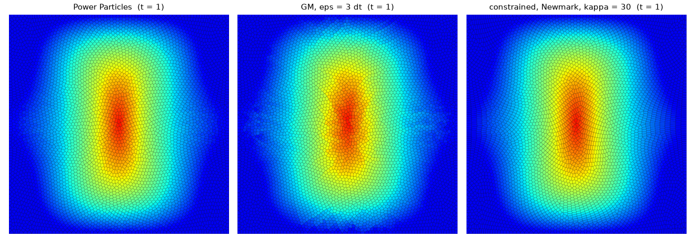

# Overnight report (2026-11-24/25): toward a variational, PP-like constrained integrator

Goal: a variational (symplectic) integrator, as stable as Power Particles and with similar
results, ideally built on Sec. 4 (the joint dual G and the softened dual G_alpha). Two ideas
were tested: (A) the explicit constrained integrator of Sec. 5.2 with the softened potential of
Sec. 5.3, and (B) a Newmark time discretization of the constrained integrator.

**Summary.**
- (A) does not work: the explicit correction itself fails at dt = 0.01 (even with no
  potential), and at small dt the bounded softened force cannot hold the generators.
- (B) Newmark (theta = 1/4) is the right time discretization: variational, stable at PP's
  dt = 0.01, each step one concave G_alpha maximization with the gauge constraints of Sec. 5.2.
  It conserves energy better than PP and GM and keeps volumes and centroids exact.
- But its scale kappa of the potential faces a trade-off. With kappa <= 100 the generators
  drift and runs break down (t ~ 0.8-2 on the squares, ~1 on a corner-free disk). With
  kappa >= 1000 they survive (disk and one-vortex to T = 3) but 15-50 % of the kinetic energy
  moves into kappa Phi, which acts as a shear elasticity of the cells (PP keeps 99.5 %). At
  strained corners (four-vortex) every kappa breaks down at t ~ 1.
- This is GM's dilemma in another form: a conservative regularization stores energy, PP's
  dissipative one does not. See "The trade-off behind all the failures" and "Next options".

## Setup

- Inputs: the uniform four-vortex case (experiments/pp2d/yesweights/uniform_5k_4vort_centroidal.pp)
  and a new one-vortex case on the same particles (uniform_5k_1vort_centroidal.pp; the field of the
  original code, Sim::add_1vortex_vel, scale 0.1, evaluated at the BNOT positions:
  `bnot_centroidal.py --velocity 1vortex`). n = 5000, domain [-1/2, 1/2]^2, dt = 0.01 unless noted.
- Baselines: PP, and GM with eps = 3 dt (kappa = 1111).
- Every run solves its steps to 1e-8 (volume and shift). Frames are saved every 10 steps, so the
  failure times below are within 10 steps (0.1 time units). Runs went 3-4 in parallel, so no
  timings are reported. The run directories are in /tmp/night (not kept).

## What was implemented

- Constrained integrator (src/core/constrainedIntegrator.cpp, options in src/core/integrator.h):
  - `ConstrainedPotential::Softened`: the force of the potential max G_alpha (Sec. 5.3) with sites
    and targets at the particles, -(1 + 1/alpha) u_alpha, in the prediction (33a); the correction
    (34) is unchanged. runPP2D `--potential softened --alpha A`.
  - `_newmarkTheta` (runPP2D `--theta T`): the family
    q+ - 2q + q- = dt^2 kappa (theta f+ + (1 - 2 theta) f + theta f-) - gauge, f = q - p,
    with the implicit part folded into the correction: maximize G_alpha with sites q^k, targets
    a = (pred - beta q^k)/(1 - beta) and 1/alpha = beta/(1 - beta), beta = theta kappa dt^2,
    under the gauge constraints (34) (ConstrainedJointSolver::SetSoftening). theta = 0 is the
    Stormer-Verlet scheme of eq. 32, 1/4 the average-acceleration Newmark scheme (variational:
    Kane, Marsden, Ortiz and West 2000), 1 the force at the new step only (dissipative).
    ParticleState::_forces carries f of the previous step.
  - GetPotential() reports kappa (Q + R), so that energy.csv's total is the energy of the
    scaled Lagrangian.
- runPP2D: `--theta`, `--potential softened`, `--retry N` (halve a failed step up to N times),
  `--stretchlimit`, `--pairreg` (solver safeguards), and `--log` prints the gauge.
- experiments/pp2d/summarize_runs.py: K/K0, energy drift, volume error, centroid gap, Newton
  iterations, closest pair and generator offset per run.

## (A) Explicit with the softened potential: does not work

| case | kappa | alpha | dt | result |
|---|---|---|---|---|
| four-vortex | 1, 10, 100 | 10, 100, 1000 | 0.01 | all fail within the first 10 steps |
| one-vortex | 1, 10, 100 | 10, 100, 1000 | 0.01 | all fail within the first 10 steps |
| four-vortex | 100 | 10, 100 | 0.001 | fail at steps 19 and 23 (t ~ 0.02) |

Why:
1. The explicit correction itself fails at dt = 0.01: with no potential at all (kappa = 0) the
   constrained step fails at step 2. The correction moves along the old generators p^k and
   finds no realizable point on that line when they turn fast within a step. No change of the
   force in the prediction can fix this.
2. At dt = 0.001 the bounded force of the softened potential cannot hold the generators: the
   runs fail at the same time as with kappa = 0 or 1 (generator drift). Its Hessian bound
   2 kappa (1 + alpha) Vbar, which made it attractive, also means it has no gain on the
   generator offset; the quantization potential holds the generators precisely through the
   amplification A (~4e4) that makes it stiff.

## (B) Newmark: works at dt = 0.01, until a breakdown at t ~ 1

First screen (dt = 0.01; theta = 1/4 unless noted; failure time to within 0.1):

| run | four-vortex | one-vortex |
|---|---|---|
| theta = 0.01, kappa 100 | fails within 10 steps | fails within 10 steps |
| theta = 0.05, kappa 100 | fails within 10 steps | fails within 10 steps |
| kappa 1 | fails within 10 steps | fails within 10 steps |
| kappa 10 | t ~ 0.9-1.0 | t ~ 2.1 |
| **kappa 30** | **reaches T = 1** | t ~ 1.8 |
| kappa 100 | t ~ 0.8 | t ~ 1.5 |
| kappa 300 | t ~ 0.8-0.9 | - |
| kappa 1000 | t ~ 0.8-0.9 | t ~ 3.2 |
| theta = 0.5, kappa 100 | t ~ 0.8-0.9 | t ~ 1.7-1.8 |
| theta = 1, kappa 100 | reaches T = 1 (fails at ~1.05-1.2) | t ~ 1.7 |
| kappa 100, dt = 0.005 | t ~ 0.81-0.85 | - |
| PP, GM | run to T = 10 | run to T = 10 |

- theta >= 1/4 is needed, the classical threshold of unconditional stability in this family;
  theta = 0.01 and 0.05 fail at once. The implicit term also softens the correction (G_alpha
  instead of G), so the correction always has a unique maximizer: the explicit failure mode of
  (A).1 disappears.
- Halving the time step does not move the breakdown (kappa 100: t ~ 0.82 at dt = 0.01 and
  0.81-0.85 at dt = 0.005): it is in the dynamics, not in the time integration.
- Retrying failed steps with half the step (`--retry 3`) gains little: four-vortex t ~ 0.8-1.2,
  one-vortex t ~ 1.5-2.2.
- Resolution: theta = 1/4, kappa = 30 breaks at t ~ 1.4-1.5 (n = 200), 1.1-1.2 (n = 1000),
  1.0-1.1 (n = 5000), while PP runs to T = 3 at all three. The breakdown time is set by the flow.

Quality against PP and GM, four-vortex case, T = 1:

| run | K/K0 | energy drift | volume error | centroid gap | closest pair | max \|u\| |
|---|---|---|---|---|---|---|
| PP | 0.997 | 2.7e-3 | 5.4e-3 | 0.13 h | 0.70 h | - |
| GM, eps = 3 dt | 0.795 | 2.3e-4 | 4e-9 | 0.23 h | 0.57 h | 0.12 h |
| Newmark, kappa 30 | 0.984 | 8.7e-5 | 1e-8 | 3e-6 h | 0.57 h | 0.60 h |
| theta = 1, kappa 100 | 0.957 | 1.4e-4 | 4e-9 | 3e-6 h | 0.57 h | 0.55 h |
| Newmark, kappa 10 (at t ~ 0.8) | 0.996 | 2.7e-5 | 8e-9 | 3e-6 h | 0.58 h | 1.03 h |

The constrained Newmark scheme conserves the total energy best of the three (1e-4), keeps the
volumes and the centroids exact, and keeps more kinetic energy than GM; its particles cluster a
little more than PP's (closest pair 0.57 h against 0.70 h), and a smaller kappa keeps more
kinetic energy (less exchange with kappa Phi) but breaks down earlier. At t = 1 the three
diagrams show the same deformation; the constrained cells are the most regular. Each step costs
~10 Newton iterations of the bordered system (PP: one Poisson solve; GM: 2-3 Newton steps).

## Why Newmark breaks down

1. **Flips next to strained corners (four-vortex).** The corners of the four-vortex flow are
   stagnation points with strain rate 2 pi 0.1 ~ 0.6, so a corner cell is squeezed by a factor
   ~ 2 by t ~ 1. Every four-vortex failure is at a corner cell (0.3-0.9 h from the walls). In
   the kappa = 100 run, the bottom-right corner cell gains a neighbour (step ~70) and loses
   another (its facet shrinks to 0.0011, then 0.0003, and vanishes at step 81); its generator
   offset grows by ~1.5 per step meanwhile (0.20 h, 0.30 h, 0.49 h) and points out of the
   domain, roughly as 1 / (facet length). Keeping the particle exactly at its centroid through
   such a boundary flip asks for a generator excursion that diverges; interior flips do not
   (an earlier run survived many). No cut cell is involved (the integrator's dual graph has
   none in these runs).
2. **Newton stalls (one-vortex).** At the one-vortex failures (kappa 100, step 173) no cell
   runs away (offsets <= 0.57 h, in the interior): the volume residual converges to 1e-9 but
   the shift residual stays at ~9e-4 for 90 iterations with accepted steps and a flat
   objective. This is not the solver's safeguards (the same failure at step 173 with the pair
   regularization and the stretch limit disabled) and step halving does not cure it. G_alpha
   is concave with a unique maximizer, so a likely reading is that the constrained maximizer
   lies at the edge of the region where the diagram is valid (distinct generators, non-empty
   cells), which Newton approaches without reaching. Not verified.
3. **Rare solver failures.** The solver is multithreaded and not bitwise reproducible: of three
   identical one-vortex runs, two failed at step 173 and one at step 14 ("damping failed"),
   with trajectories that agreed to 1e-11 at step 10. Failure times have a random component.

## Second round: a disk, larger kappa, a cold start

**A cold-start fallback.** On the disk, some steps failed in the volume solve that sets up the
start (at the particles, warm-started from the shifted weights of the generators, which can
leave empty cells at the particles). The step now restarts that solve from zero weights (the
Voronoi cells of the particles) when the warm start fails.

**A disk without corners** (experiments/pp2d/disk/make_disk.py: a 128-gon of radius 1/2, 1958
particles relaxed by Lloyd, the differential rotation v_theta = 4 U (r/R)(1 - r^2/R^2), peak 0.1;
shear everywhere, no stagnation corner), dt = 0.01, T = 3, `--retry 3`:

| run | result | K/K0 [min] | energy drift | closest pair | max \|u\| |
|---|---|---|---|---|---|
| PP | T = 3 | 0.993 | 7.3e-3 | 0.75 h | - |
| GM, eps = 3 dt | T = 3, unstable (K peaks at 24 K0) | 1.17 | 1.3e-1 | 0.50 h | 0.13 h |
| Newmark, kappa 10, 30 | fail within 10 steps | | | | |
| Newmark, kappa 100 | fails at t ~ 1.0-1.1 | | | | |
| Newmark, kappa 300 | fails at t ~ 2.9 | 0.877 | 6.5e-4 | 0.71 h | 1.96 h |
| Newmark, kappa 1000 | T = 3 | 0.842 [0.822] | 1.1e-3 | 0.73 h | 0.35 h |
| Newmark, kappa 3000 | T = 3 | 0.863 [0.778] | 1.7e-4 | 0.75 h | 0.14 h |
| theta = 1, kappa 1000 | T = 3 | 0.831 [0.818] | 2.9e-3 | 0.73 h | 0.13 h |

So the corners are not the only cause: with kappa <= 100 the disk breaks too (the failing steps
show the residual stuck while the objective creeps up, as in the one-vortex stalls).

**Larger kappa on the squares** (dt = 0.01, `--retry 3`):

| run | four-vortex | one-vortex (K/K0 at T = 3) |
|---|---|---|
| Newmark, kappa 1000 | fails at t ~ 0.9-1.0 | T = 3 (0.708) |
| Newmark, kappa 3000 | fails at t ~ 1.0-1.1 | T = 3 (0.474) |
| theta = 1, kappa 1000 | fails at t ~ 0.9-1.0 | T = 3 (0.683) |
| PP | T = 2 | T = 3 (0.995) |

## The trade-off behind all the failures

- **Small kappa (<= 100):** the generators drift from the particles and the correction cannot
  reach the realizable set. A variational step of this Lagrangian must correct along the
  current normal p^k (this follows from the discrete kinetic energy |c^{k+1} - c^k|^2: written in
  generator coordinates p, with c = c(p) always realizable, its discrete Euler-Lagrange equations
  are exactly eq. 32), and the normals of the realizable set turn fast (amplification A ~ 4e4).
  Newmark relaxes the correction only by u / alpha with 1/alpha ~ theta kappa dt^2.
- **Large kappa (>= 1000):** the runs survive (disk, one-vortex to T = 3) but 15-50 % of the
  kinetic energy moves into kappa Phi. Phi is the quantization error, a measure of the cell
  shapes, so kappa Phi acts as a shear elasticity: the flow shears the cells, Q grows, and the
  energy comes from the flow. Little drain needs kappa dQ << K, i.e. kappa << K / Q ~ 0.005 / 3e-5
  ~ 150 here; holding the generators needs kappa >~ 300-1000. There is no window at n = 5000,
  and both bounds scale like n (Q ~ h^2), so refining does not open one.
- **Strained corners (four-vortex):** fail at t ~ 1 for every kappa.

This is GM's dilemma in another form: a conservative scheme that keeps the particle
arrangement regular stores the regularization energy, and that energy behaves like a shear
elasticity. PP keeps the arrangement regular by discarding that energy (the Lloyd step and the
projection that drops the Lloyd velocity), which no symplectic scheme can do. The exact-centroid
constraint stores no energy, but alone it does not keep the arrangement regular (kappa = 0
breaks down at t ~ 0.02).

## Conclusions

- The time discretization is settled: Newmark (theta = 1/4) is variational, unconditionally
  stable on the stiff soft generator modes that defeat Stormer-Verlet, and each step is one
  concave maximization of G_alpha with the gauge constraints of Sec. 5.2, so it uses Sec. 4
  directly. The explicit scheme of Sec. 5.2 cannot work at useful time steps, with any
  potential.
- The remaining obstacle is the model: exact centroids plus walls. Near strained corners, the
  diagram that keeps the particles at their centroids needs generators that run away. PP and
  GM never meet this because their generators are the particles.
- kappa (the scale of the potential) is still a parameter. It trades kinetic energy (small
  kappa) against holding the generators (large kappa); kappa = 30 works best here.

## Next options

0. Decide whether the goal should allow the regularization to be non-conservative only on the
   particle-scale modes (as PP does), with the flow-scale dynamics variational; or keep it fully
   conservative and accept a shear elasticity kappa Phi (then choose kappa for the drain, and
   study when the breakdown happens).

1. A variational integrator in generator coordinates with a midpoint discrete kinetic energy
   (the centroid Jacobian dc/dp, from the blocks of the Hessian of G, at the midpoint): its
   correction follows the normal at the midpoint rather than at q^k, and there is no line to
   miss. Each step is a Newton solve in p.
2. Mirrored generators across the walls, which turn the boundary flips at the strained corners
   into interior ones (the disk test shows this alone is not enough at small kappa).
3. At a stalled step, locate the residual (cells and constraint rows) and check whether the
   constrained maximizer of G_alpha is in the valid region.
4. If the stalls are a solver issue, accept a step whose residual has stalled below a looser
   bound (1e-3 of the cell size, PP's own volume errors are 5e-3).
5. Choose kappa from the flow (the regularization must act faster than the shear h/v) and
   check the scaling with n and the speed.
